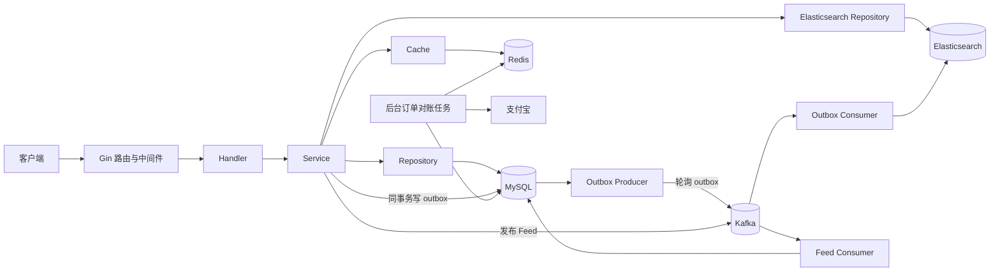

# Fiction Book Backend

小说阅读平台后端服务。基于 **Go + Gin + MySQL + Redis + Elasticsearch + Kafka**，提供用户与认证、书籍与章节、付费阅读、VIP、书架与关注、Feed 流、金币充值订单与支付宝支付等能力。

- 接口文档：[doc/API.md](./doc/API.md)
- 数据表文档：[doc/MODEL.md](./doc/MODEL.md)
- 在线接口调试：启动后访问 `/swagger/index.html`

---

## 功能概览

### 账号与认证

- 用户名 / 邮箱 / 密码注册，邮箱验证码校验（Resend 发送，Redis 保存 5 分钟）
- 登录签发 AccessToken + RefreshToken，JWT HS256
- RefreshToken 写入 Redis 白名单，同一用户仅保留最新一条，实现单点登录与 Token 轮换
- 修改资料、修改密码、更换邮箱、忘记密码、管理员删除账号
- 头像上传（PNG/JPG，精确 180×180，≤ 2 MB），本地静态目录托管

### 书籍与章节

- 书籍创建、详情、分页列表、信息更新、封面上传（JPG，精确 368×460，≤ 10 MB）
- 章节创建、编辑、删除、目录、章节信息与正文读取
- 书籍所有权校验：只有作者可以修改书籍、维护章节与封面
- 书籍标签维护（每本 1~3 个，标签集合由 `config/data.yaml` 初始化）
- 书籍 / 章节关键字搜索，基于 Elasticsearch，支持多条件过滤、排序与高亮
- 日 / 周 / 月热度榜单，基于 Redis ZSet 聚合

### 阅读、互动与 Feed

- 章节访问控制：已购买章节或 VIP 等级足够时可读；免费章节支持游客阅读
- 金币购买书籍 / 章节，作者获得 50% 金币收益（向上取整）
- 书架增删与查询、关注 / 取关、关注状态查询
- 阅读热度与阅读字数统计，带 1 分钟 / 5 分钟频控，避免刷量
- Feed V2：作者发布书籍后产生 Feed，经 Kafka 扇出到粉丝收件箱，支持游标分页与游客全局时间线（新章节通知仍走旧版 `feed_inbox` 链路）

### 商业化

- 金币充值订单：创建支付宝订单、长轮询查询支付结果、超时关单
- 支付宝异步通知验签、金额校验、发放金币（幂等）
- 后台订单对账任务：定时查询未支付订单，处理已支付补单与超时关单
- VIP 购买、续费、`vip_1 → vip_2` 升级，价格由配置驱动

### 工程能力

- 事务性 Outbox：业务写入与事件写入同事务，后台投递 Kafka，最终同步 Elasticsearch
- Kafka 消费幂等：`consume_record` 去重，失败重试不重复写入
- 缓存旁路 + 分布式锁 + 随机 TTL 抖动，降低缓存击穿与雪崩
- 统一错误码与响应结构、参数校验、JWT 认证、管理员权限中间件
- Zap 日志、Sentry、OpenTelemetry、Pprof（按配置启用）
- Swagger 文档、Wire 依赖注入、GitHub Actions（build / race test / gofmt / vet）

---

## 技术栈

| 类别 | 技术 | 用途 |
| --- | --- | --- |
| 语言 | Go 1.24（`go.mod` / CI） | 服务端实现 |
| Web 框架 | Gin v1.9 | 路由、中间件、参数绑定 |
| ORM / 数据库 | GORM v1.31 + MySQL 8 | 业务数据持久化、事务 |
| 缓存 | Redis 7 + go-redis v9 | 会话白名单、验证码、热点缓存、分布式锁、排行榜 |
| 搜索 | Elasticsearch 8 + go-elasticsearch v8 | 书籍 / 章节全文检索与高亮 |
| 消息队列 | Kafka 4（kafka-go） | Outbox 数据同步、Feed 推送 |
| 认证 | golang-jwt/jwt v5 | AccessToken / RefreshToken |
| 配置 | Viper | YAML 配置 + 环境变量覆盖 |
| 依赖注入 | Google Wire | 编译期依赖装配 |
| 参数校验 | go-playground/validator v10 | DTO 校验与自定义 `username` 规则 |
| 文档 | Swag + gin-swagger | OpenAPI / Swagger UI |
| 日志 | Uber Zap | 结构化日志 |
| 可观测性 | Sentry、OpenTelemetry（OTLP） | 错误追踪、链路追踪 |
| 并发任务 | agilePool v2 | 后台任务池（阅读统计、订单任务） |
| 支付 | go-pay/gopay（支付宝） | 下单、查单、关单、回调验签 |
| 邮件 | Resend | 邮箱验证码 |
| 图片存储 | 本地 `upload/` + 静态路由 | 头像、书籍封面；`pkg/oss` 预留阿里云 OSS 能力 |
| 测试 | testify、SQLite、miniredis | 单元测试与集成测试 |
| CI | GitHub Actions | Go 1.24，build / test -race / gofmt / vet |

> 微信支付配置结构已预留，但当前仅接入支付宝。

---

## 系统架构



请求链路固定为：

```text
router -> middleware -> handler -> service -> repository / cache
```

- Handler 只做参数读取、调用 Service、输出统一响应，不直接访问数据库。
- 跨表原子写入在 Service 中通过 `db.Transaction` 组织，并把 `tx` 传给 Repository。
- 书籍、章节、封面等写操作在同一事务中写入 `outbox`，由后台投递 Kafka，再同步 Elasticsearch。
- 所有外部调用都使用 `c.Request.Context()` 派生的上下文。

---

## 目录结构

```text
.
├─ cmd/
│  ├─ server/            # HTTP 服务入口（main.go）
│  ├─ init_data/         # 初始化数据脚本
│  └─ test/              # 调试 / 辅助脚本
├─ internal/
│  ├─ api/
│  │  ├─ router/         # /api/v1、/api/v2 路由注册
│  │  ├─ middleware/     # 认证、校验、日志、恢复、CORS、Sentry、Tracing、Pprof
│  │  └─ handler/        # HTTP 处理器
│  ├─ dto/               # 请求 / 响应结构与校验标签
│  ├─ service/           # 业务编排、事务、异步任务
│  ├─ repository/        # MySQL / Elasticsearch 数据访问
│  ├─ cache/             # Redis 缓存与分布式锁
│  ├─ model/             # GORM 模型与领域枚举
│  ├─ kafka/             # Outbox、Feed 的生产者与消费者
│  ├─ server/            # 订单对账后台服务
│  └─ wire/              # Wire Provider Set 与生成代码
├─ pkg/                  # 跨模块基础能力：config/database/redisclient/jwt/logger/response/payment/email/...
├─ migrations/           # 向前 SQL 迁移
├─ config/
│  ├─ config.example.yaml
│  ├─ config.docker.yaml
│  └─ data.yaml          # 书籍标签等数据配置
├─ doc/                  # API.md、MODEL.md
├─ openapi/              # swag 生成产物（勿手工编辑）
├─ upload/               # 本地上传文件（头像、封面）
├─ Dockerfile
├─ docker-compose.yml
└─ Makefile
```

---

## 快速开始

### 1. 环境要求

| 组件 | 版本 |
| --- | --- |
| Go | 1.24+（CI 使用 1.24.x，勿使用 1.25+ API） |
| MySQL | 8.0+ |
| Redis | 7+ |
| Elasticsearch | 8.x |
| Kafka | 4.0（开发环境由 compose 提供） |

### 2. 准备配置

```bash
cp config/config.example.yaml config/config.yaml
```

编辑 `config/config.yaml`，至少填写：

- `mysql.host / port / database / username / password`
- `redis.host / port / password / db`
- `elasticsearch.address`
- `kafka.addr`
- `jwt.secret`
- `resend.api_key`（需要邮箱验证码时）
- `payment.alipay.*`（需要充值时）
- `server.website`：生成头像 / 封面绝对 URL 的站点前缀

`config/config.yaml` 已被 `.gitignore` 忽略，包含密钥，不要提交。书籍标签从 `config/data.yaml` 的 `book_tags` 合并加载。

开发环境如希望自动建表，可在配置中增加：

```yaml
mysql:
  enable_auto_migrate: true
```

否则手动执行：

```bash
mysql -u root -p <your_database> < migrations/init.sql
mysql -u root -p <your_database> < migrations/add_user_feed_inbox_tables.sql
```

> `add_user_feed_inbox_tables.sql` 内部包含 `USE gsf;`，执行前请改成实际数据库名，或手动去掉该行。

### 3. 启动依赖

```bash
docker compose up -d mysql redis elasticsearch kafka
```

`docker-compose.yml` 提供单节点开发环境：

- MySQL `localhost:3306`
- Redis `localhost:6379`
- Elasticsearch `localhost:9200`（关闭安全认证）
- Kafka `localhost:9092`（KRaft 单节点）

> 注意：应用镜像在构建时会把 `config/config.docker.yaml` 复制为 `config/config.yaml`。Compose 中的 `DB_HOST`、`REDIS_HOST` 等变量不会被 Viper 读取，不要把连接信息只写在 compose 环境变量里。

### 4. 启动服务

```bash
go run cmd/server/main.go
```

启动后：

- 健康检查：`GET http://localhost:8080/api/health`
- Swagger UI：`http://localhost:8080/swagger/index.html`
- 静态文件：`http://localhost:8080/upload/...`

### 5. 常用命令

```bash
go build ./...                                      # 编译全部包
go test -race -coverprofile=coverage.txt -covermode=atomic ./...  # 测试
go vet ./...                                        # 静态检查
gofmt -l <changed files>                            # 格式检查
swag init -g cmd/server/main.go -o openapi --parseDependency --parseInternal  # 生成 Swagger
go run github.com/google/wire/cmd/wire ./...        # 重新生成 Wire
```

CI 实际执行：`go build ./...`、`go test -race ...`、`gofmt -l`、`go vet ./...`。

---

## 配置说明

| 配置段 | 关键字段 | 说明 |
| --- | --- | --- |
| `server` | `port`、`mode`、`website`、`read_timeout`、`write_timeout` | 监听端口、Gin 模式、静态资源绝对地址前缀 |
| `mysql` | `host`、`port`、`database`、`username`、`password`、`enable_auto_migrate` | MySQL 连接与自动迁移开关 |
| `redis` | `host`、`port`、`password`、`db` | 缓存与会话 |
| `elasticsearch` | `address`、`username`、`password` | 搜索集群 |
| `kafka` | `addr`、`topic.database_sync`、`topic.feed` | Outbox 与 Feed Topic |
| `jwt` | `secret`、`expire`、`refresh_expire` | Token 密钥与有效期（秒） |
| `resend` | `from`、`api_key` | 邮箱验证码发送 |
| `payment.alipay` | `app_id`、`private_key`、`public_key`、`alipay_public_key`、`notify_url` | 支付宝下单与回调 |
| `purchased` | `vip_1.month/year`、`vip_2.month/year`、`currency_ratio` | VIP 价格与金币兑换比例 |
| `setting` | `order_consume_num` | 订单对账并发工作协程数 |
| `pprof` / `sentry` / `tracing` | `enabled` 等 | 可观测性开关 |
| `book_tags` | `config/data.yaml` | 书籍标签白名单 |

环境变量覆盖需使用与 Viper 键名一致的形式，例如 `MYSQL.HOST`、`REDIS.PASSWORD`；`DB_HOST` 这类变量不会生效。

---

## 核心流程

### 认证

1. 注册时校验邮箱验证码（`debug` 模式可跳过校验），创建 `user`、`user_info`、`user_asset` 三条记录。
2. 登录校验密码后签发 AccessToken 与 RefreshToken；RefreshToken 写入 `GSF:auth:refresh:token:{userID}`。
3. 业务接口携带 `Authorization: Bearer <AccessToken>`。
4. AccessToken 过期返回业务码 `4027`，客户端用 `/auth/refresh` 换取新 Token；RefreshToken 只能使用白名单中的最新一条。

### 阅读与购买

1. 读取章节时先查购买记录，再比较 VIP 等级；通过后写入阅读统计与热度。
2. 购买书籍 / 章节在事务内校验价格、扣减金币、写入购买记录，并把 50% 金币结算给作者。
3. 阅读会累加浏览量，收藏会以更高权重增加热度；热度异步回写 MySQL，并进入 Redis 榜单与统计缓存。

### Feed

1. 作者发布书籍时，在同一事务内写入书籍、`user_feed` 与 Outbox；事务提交后把 Feed 消息投递到 `feed_push`。
2. 消息投递到 `feed_push` Topic，消费者按粉丝列表扇出 `user_inbox`，并用 `consume_record` 保证幂等。
3. 查询时按收件箱游标分页，聚合书籍、作者、粉丝数、书架 / 关注状态后返回。

### 数据同步

```text
业务事务 -> outbox(created) -> Kafka(database_sync) -> 消费 -> 写 ES -> outbox(finished)
```

Outbox 生产者每 30 秒扫描一次待投递事件；消费者按 `type`（`book` / `book_chapter`）和 `operation`（`create` / `update` / `delete`）同步 Elasticsearch。

### 订单与支付

1. 创建充值订单：校验收到的金币数 `price × currency_ratio == reward_gold`，创建支付宝订单，写入订单临时轮询集合。
2. 客户端轮询 `GET /api/v1/orders/{id}`，服务端对待支付订单最多保持连接 30 秒。
3. 支付宝异步通知验签、校验金额后发放金币并更新订单状态。
4. 后台任务每 5 秒扫描临时订单，主动查单：已支付补发金币，超时或关闭则关单。

---

## 接口约定

- 路由前缀：`/api/v1`、`/api/v2`；健康检查 `/api/health`。
- JSON 接口统一返回 HTTP 200，业务结果看响应体 `code`：

```json
{
  "code": 200,
  "message": "success",
  "data": {}
}
```

- 错误响应：`{ "code": 4001, "message": "书籍未找到" }`，错误码定义见 `pkg/response/errors.go`，属于兼容性契约，不应复用或修改。
- 认证头：`Authorization: Bearer <AccessToken>`。
- 分页：页码从 1 开始，`size` 默认 10、最大 100；搜索与 Feed 使用游标分页。
- 时间：查询过滤使用 Unix 秒；书籍 / Feed 响应时间戳为 Unix 秒；用户时间为 `YYYY-MM-DD HH:mm:ss`；订单等结构使用 RFC3339。

完整路径、参数、响应字段与错误码见 [doc/API.md](./doc/API.md)。

---

## 数据与存储

- MySQL：用户、资产、书籍、章节、标签、购买、书架、关注、订单、Feed、Outbox 等 16 张业务表，另有 2 张兼容旧版 Feed 的表。
- Redis：缓存、锁、验证码、Token 白名单、排行榜，统一使用 `GSF:` 前缀。
- Elasticsearch：索引名与表名一致，当前为 `book`、`book_chapter`。
- Kafka Topic：`database_sync`（Outbox → ES）、`feed_push`（Feed 扇出）。

详见 [doc/MODEL.md](./doc/MODEL.md)。

---

## 测试

```bash
go test ./...
go test -race ./...
go test ./internal/service -run TestName
```

- Repository / Service 测试使用 SQLite 内存库，缓存测试使用 `miniredis`。
- Mock 采用手写 `testify/mock`，位于 `internal/service/service_mocks_test.go`。
- Handler 测试使用 `gin.TestMode` + `httptest`，需初始化 logger 与 validator。
- 涉及 goroutine、缓存、消息队列的改动请使用 `-race` 验证，不要依赖 `time.Sleep` 做时序断言。

---

## 文档

- [API 接口文档](./doc/API.md)
- [数据库模型文档](./doc/MODEL.md)
- Swagger：`/swagger/index.html`（源码注解生成，勿手工编辑 `openapi/`）

## 致谢

项目脚手架参考 [github.com/d60-Lab/gin-template](https://github.com/d60-Lab/gin-template)。
