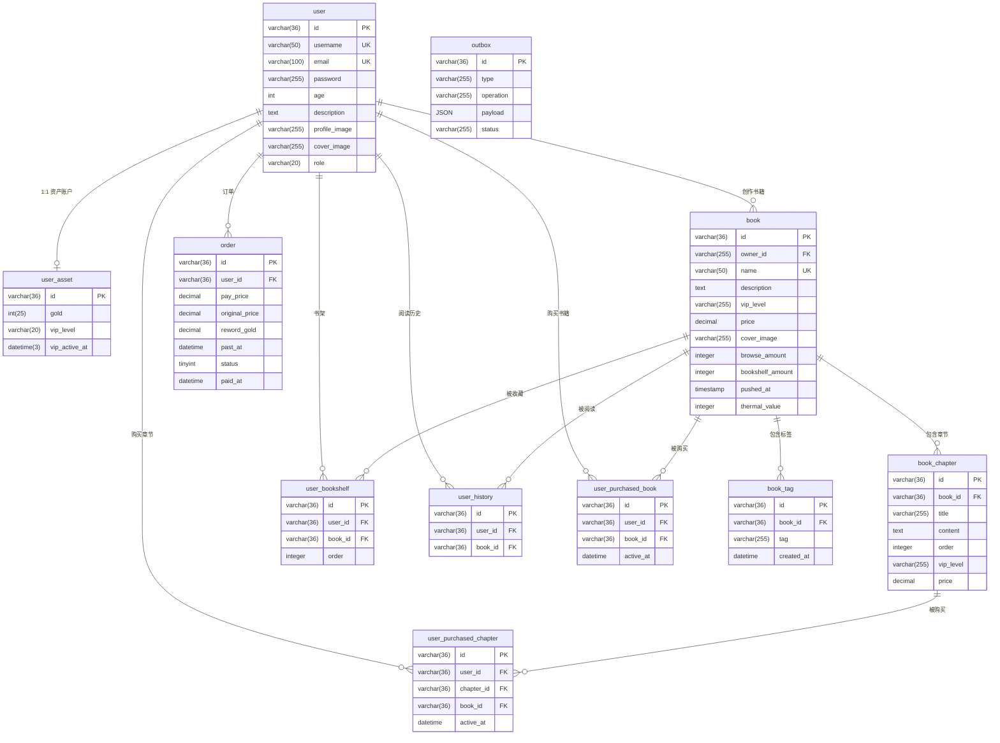

# 数据库模型文档

## 概览

本项目为小说阅读平台后端，数据库共包含 **11 张表**，涵盖用户、书籍、章节、书籍标签、订单、书架、阅读历史、购买记录、资产及事务性发件箱。

---

## ER 关系图

---

## 表结构详情

### `user` — 用户表

| 字段 | 类型 | 约束 | 说明 |
|------|------|------|------|
| id | varchar(36) | PK | UUID |
| username | varchar(50) | UNIQUE, NOT NULL | 用户名 |
| email | varchar(100) | UNIQUE, NOT NULL | 邮箱 |
| password | varchar(255) | NOT NULL | 密码（哈希） |
| age | int | | 年龄 |
| description | text | | 个人简介 |
| profile_image | varchar(255) | | 头像 URL |
| cover_image | varchar(255) | | 封面图 URL |
| role | varchar(20) | DEFAULT 'user' | 角色（user / admin 等） |
| created_at | datetime | | |
| updated_at | datetime | | |
| deleted_at | datetime | INDEX | 软删除 |

---

### `user_asset` — 用户资产表

与 `user` 为 **1:1** 关系，`id` 与用户 ID 相同。

| 字段 | 类型 | 约束 | 说明 |
|------|------|------|------|
| id | varchar(36) | PK | 与 user.id 一致 |
| gold | int(25) | NOT NULL | 金币余额 |
| vip_level | varchar(20) | NOT NULL | VIP 等级 |
| vip_active_at | datetime(3) | | VIP 到期时间 |
| created_at | datetime | | |
| updated_at | datetime | | |
| deleted_at | datetime | INDEX | 软删除 |

---

### `book` — 书籍表

| 字段 | 类型 | 约束 | 说明 |
|------|------|------|------|
| id | varchar(36) | PK | UUID |
| owner_id | varchar(255) | FK → user.id | 作者/拥有者 |
| name | varchar(50) | UNIQUE, NOT NULL | 书名 |
| description | text | NOT NULL | 简介 |
| vip_level | varchar(255) | | 所需 VIP 等级 |
| price | decimal(10,0) | | 购买价格（金币） |
| cover_image | varchar(255) | NOT NULL | 封面图 URL |
| browse_amount | integer | DEFAULT 0 | 浏览量 |
| bookshelf_amount | integer | DEFAULT 0 | 收藏量 |
| pushed_at | timestamp | NOT NULL | 发布时间 |
| thermal_value | integer | DEFAULT 0 | 热度值（= bookshelf_amount×10 + browse_amount） |
| created_at | datetime | | |
| updated_at | datetime | | |
| deleted_at | datetime | INDEX | 软删除 |

**热度计算公式：** `thermal_value = bookshelf_amount * 10 + browse_amount`

---

### `book_chapter` — 书籍章节表

| 字段 | 类型 | 约束 | 说明 |
|------|------|------|------|
| id | varchar(36) | PK | UUID |
| book_id | varchar(36) | FK → book.id | 所属书籍 |
| title | varchar(255) | | 章节标题 |
| content | text | | 章节正文 |
| order | integer | NOT NULL, DEFAULT 1 | 章节顺序 |
| vip_level | varchar(255) | | 所需 VIP 等级 |
| price | decimal(10,0) | | 单章购买价格（金币） |
| created_at | datetime | | |
| updated_at | datetime | | |
| deleted_at | datetime | INDEX | 软删除 |

---

### `book_tag` — 书籍标签表

记录书籍的分类标签，一本书可拥有多个标签。标签不支持原地更新，变更时删除旧记录再新增。

| 字段 | 类型 | 约束 | 说明 |
|------|------|------|------|
| id | varchar(36) | PK | UUID |
| book_id | varchar(36) | FK → book.id, INDEX | 所属书籍 |
| tag | varchar(255) | NOT NULL | 标签值（`SingleBookTag` 类型） |
| created_at | datetime | | |

---

### `user_bookshelf` — 用户书架表

记录用户收藏/加入书架的书籍。

| 字段 | 类型 | 约束 | 说明 |
|------|------|------|------|
| id | varchar(36) | PK | UUID |
| user_id | varchar(36) | FK → user.id, INDEX | 用户 |
| book_id | varchar(36) | FK → book.id, INDEX | 书籍 |
| order | integer | NOT NULL, DEFAULT 1 | 书架排序 |
| created_at | datetime | | |
| updated_at | datetime | | |
| deleted_at | datetime | | 软删除 |

---

### `user_history` — 用户阅读历史表

| 字段 | 类型 | 约束 | 说明 |
|------|------|------|------|
| id | varchar(36) | PK | UUID |
| user_id | varchar(36) | FK → user.id, NOT NULL | 用户 |
| book_id | varchar(36) | FK → book.id, NOT NULL | 书籍 |
| created_at | datetime | | 最近阅读时间 |
| updated_at | datetime | | |
| deleted_at | datetime | INDEX | 软删除 |

---

### `user_purchased_book` — 用户购书记录表

| 字段 | 类型 | 约束 | 说明 |
|------|------|------|------|
| id | varchar(36) | PK | UUID |
| user_id | varchar(36) | FK → user.id, INDEX | 用户 |
| book_id | varchar(36) | FK → book.id, INDEX | 购买的书籍 |
| active_at | datetime | INDEX | 购买生效时间 |
| created_at | datetime | INDEX | |
| updated_at | datetime | INDEX | |
| deleted_at | datetime | INDEX | 软删除 |

---

### `user_purchased_chapter` — 用户购章节记录表

| 字段 | 类型 | 约束 | 说明 |
|------|------|------|------|
| id | varchar(36) | PK | UUID |
| user_id | varchar(36) | FK → user.id, INDEX | 用户 |
| chapter_id | varchar(36) | FK → book_chapter.id, INDEX | 购买的章节 |
| book_id | varchar(36) | FK → book.id, INDEX | 冗余字段，便于按书查询 |
| active_at | datetime | INDEX | 购买生效时间 |
| created_at | datetime | INDEX | |
| updated_at | datetime | INDEX | |
| deleted_at | datetime | INDEX | 软删除 |

---

### `order` — 订单表

| 字段 | 类型 | 约束 | 说明 |
|------|------|------|------|
| id | varchar(36) | PK | UUID |
| user_id | varchar(36) | FK → user.id | 下单用户 |
| pay_price | decimal(10,2) | | 实付金额（法币） |
| original_price | decimal(10,2) | | 原价 |
| reword_gold | decimal(10,0) | | 购买后奖励金币 |
| past_at | datetime | | 订单过期时间 |
| status | tinyint | | 订单状态 |
| paid_at | datetime | NULL | 支付时间（未支付为 NULL） |
| created_at | datetime | | |
| updated_at | datetime | | |
| deleted_at | datetime | INDEX | 软删除 |

---

### `outbox` — 事务性发件箱表

实现 [Transactional Outbox Pattern](https://microservices.io/patterns/data/transactional-outbox.html)，保证数据库写入与消息发布的原子性。

| 字段 | 类型 | 约束 | 说明 |
|------|------|------|------|
| id | varchar(36) | PK | UUID |
| type | varchar(255) | | 事件类型（对应业务表名） |
| operation | varchar(255) | | 操作类型：`create` / `update` / `delete` |
| payload | JSON | | 事件负载（原始数据） |
| status | varchar(255) | | 处理状态：`created` / `progress` / `finished` |
| created_at | datetime | | |
| updated_at | datetime | | |

---

## 表关系汇总

| 关系 | 类型 | 说明 |
|------|------|------|
| user → user_asset | 1:1 | 每个用户有一个资产账户，ID 相同 |
| user → book | 1:N | 一个用户可创作多本书 |
| book → book_chapter | 1:N | 一本书包含多个章节 |
| book → book_tag | 1:N | 一本书可拥有多个标签 |
| user → user_bookshelf | 1:N | 用户可收藏多本书 |
| book → user_bookshelf | 1:N | 一本书可被多人收藏 |
| user → user_history | 1:N | 用户可有多条阅读记录 |
| book → user_history | 1:N | 一本书可被多人阅读 |
| user → user_purchased_book | 1:N | 用户可购买多本书 |
| book → user_purchased_book | 1:N | 一本书可被多人购买 |
| user → user_purchased_chapter | 1:N | 用户可购买多个章节 |
| book_chapter → user_purchased_chapter | 1:N | 一个章节可被多人购买 |
| user → order | 1:N | 用户可有多笔订单 |
