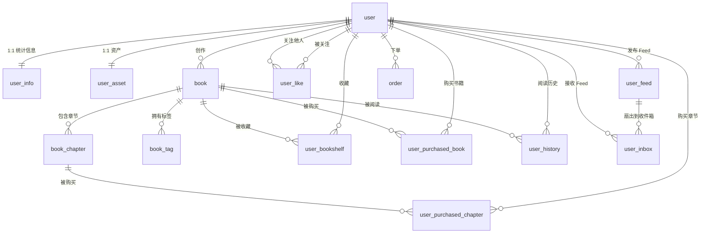

# 数据库模型文档

本文档描述小说阅读平台后端的 MySQL 数据模型、表关系、索引、状态枚举与数据一致性约定。字段、类型与索引以 `internal/model/` 中的 GORM 定义为准，并标注当前 SQL 迁移与模型之间的差异。

- 数据库：MySQL 8.0+
- ORM：GORM v1.31
- 自动迁移：`mysql.enable_auto_migrate`
- 表数量：**16 张业务表 + 2 张旧版兼容表**（不含可选的 `casbin_rule`）

---

## 1. 存储总览

| 表名 | 分类 | 说明 | 状态 |
| --- | --- | --- | --- |
| `user` | 账号 | 用户主表 | 使用中 |
| `user_info` | 账号 | 用户统计与主页信息，与 `user` 1:1 | 使用中 |
| `user_asset` | 账号 | 金币、VIP 等级与到期时间，与 `user` 1:1 | 使用中 |
| `book` | 内容 | 书籍 | 使用中 |
| `book_chapter` | 内容 | 章节正文与元信息 | 使用中 |
| `book_tag` | 内容 | 书籍标签 | 使用中 |
| `user_bookshelf` | 互动 | 用户书架 | 使用中 |
| `user_like` | 互动 | 关注关系 | 使用中 |
| `user_history` | 互动 | 旧版浏览历史 | 仅保留读取接口 |
| `user_feed` | Feed | Feed 详情 | 使用中 |
| `user_inbox` | Feed | 用户 Feed 收件箱（扇出结果） | 使用中 |
| `user_purchased_book` | 交易 | 已购书籍 | 使用中 |
| `user_purchased_chapter` | 交易 | 已购章节 | 使用中 |
| `order` | 交易 | 金币充值订单 | 使用中 |
| `consume_record` | 基础设施 | 消费 / 请求幂等记录 | 使用中 |
| `outbox` | 基础设施 | 事务性发件箱 | 使用中 |
| `feed_inbox` | Feed | 旧版 Feed（新章节通知） | 兼容保留 |
| `feed_cursors` | Feed | 旧版 Feed 游标模型 | 兼容保留 |
| `casbin_rule` | 权限 | gorm-adapter 自动建表 | 未接入启动流程 |

---

## 2. ER 关系图

> 数据库未创建物理外键，以下均为逻辑关系，由业务代码维护。



---

## 3. 表结构详情

> 通用约定：`id` 均为 UUID 字符串 `varchar(36)`；`created_at`、`updated_at` 为 `datetime(3)`；带软删除的表使用 `deleted_at datetime(3)` 并建立索引。金额、金币均使用整数或定点小数，不使用浮点存储。

### 3.1 `user` — 用户表

| 字段 | 类型 | 约束 | 说明 |
| --- | --- | --- | --- |
| `id` | varchar(36) | PK | 用户 ID |
| `username` | varchar(50) | UNIQUE, NOT NULL | 用户名，至少 3 字符且不能含空格 |
| `email` | varchar(100) | UNIQUE, NOT NULL | 邮箱 |
| `password` | varchar(255) | NOT NULL | bcrypt 哈希（cost 14），JSON 不输出 |
| `age` | int | | 年龄 |
| `description` | text | | 个人简介 |
| `profile_image` | varchar(255) | | 头像存储路径 |
| `cover_image` | varchar(255) | | 主页封面存储路径 |
| `role` | varchar(20) | DEFAULT `user` | `user` / `admin` |
| `created_at` | datetime(3) | | |
| `updated_at` | datetime(3) | | |
| `deleted_at` | datetime(3) | INDEX | 软删除 |

**索引**：`idx_user_username`（唯一）、`idx_user_email`（唯一）、`idx_user_deleted_at`。

**说明**

- `debug` 模式下注册用户名为 `admin` 时 `role` 自动设为 `admin`。
- 注册成功时同步创建 `user_info` 与 `user_asset`。

---

### 3.2 `user_info` — 用户统计信息表

与 `user` 为 **1:1**，`user_id` 即 `user.id`。

| 字段 | 类型 | 约束 | 说明 |
| --- | --- | --- | --- |
| `user_id` | varchar(36) | PK | 用户 ID |
| `username` | varchar(50) | UNIQUE, NOT NULL | 用户名冗余，便于检索 |
| `user_profile_url` | varchar(255) | NOT NULL | 头像路径 |
| `read_book_num` | bigint | NOT NULL, DEFAULT 0 | 创建书籍累计数（历史字段名） |
| `read_words_num` | bigint | NOT NULL, DEFAULT 0 | 累计阅读字数 |
| `fans_num` | bigint | NOT NULL, DEFAULT 0 | 粉丝数 |
| `like_num` | bigint | NOT NULL, DEFAULT 0 | 获赞数 |
| `book_shelf_num` | bigint | NOT NULL, DEFAULT 0 | 书架数量 |
| `last_login_ip` | varchar(50) | NULL | 最近登录 IP |
| `is_v` | tinyint | NOT NULL, DEFAULT 0 | 是否大 V：0 否，1 是 |
| `deleted_at` | datetime(3) | INDEX | 软删除 |

**索引**：`idx_user_info_username`（唯一）、`idx_user_info_deleted_at`。

**说明**

- 该表没有 `created_at` / `updated_at`。
- 创建书籍会累加 `read_book_num`（历史语义）；关注 / 取关更新 `fans_num`，达到阈值后 `is_v` 置 1。
- `read_words_num`、`like_num`、`book_shelf_num` 等字段已预留仓储方法，部分统计当前主要保存在 Redis，尚未全部回写数据库。
- 粉丝数达到 100 后 `is_v` 置 1；大 V 的 Feed 不走普通扇出推送。

---

### 3.3 `user_asset` — 用户资产表

与 `user` 为 **1:1**，`id` 即 `user.id`。

| 字段 | 类型 | 约束 | 说明 |
| --- | --- | --- | --- |
| `id` | varchar(36) | PK | 用户 ID |
| `gold` | int(25) | NOT NULL | 金币余额，不允许为负 |
| `vip_level` | varchar(20) | NOT NULL | `vip_0` / `vip_1` / `vip_2` |
| `vip_active_at` | datetime(3) | NULL | VIP 到期时间 |
| `created_at` | datetime(3) | | |
| `updated_at` | datetime(3) | | |
| `deleted_at` | datetime(3) | INDEX | 软删除 |

**说明**

- 注册时初始化为 `gold=0`、`vip_level=vip_0`、`vip_active_at=当前时间`。
- 金币增减在事务内读改写，并做溢出与负值校验。
- 购买书籍、章节、VIP 会扣减金币；作者按 50%（向上取整）获得收益。

---

### 3.4 `book` — 书籍表

| 字段 | 类型 | 约束 | 说明 |
| --- | --- | --- | --- |
| `id` | varchar(36) | PK | 书籍 ID |
| `owner_id` | varchar(255) | | 作者用户 ID |
| `name` | varchar(50) | UNIQUE, NOT NULL | 书名 |
| `description` | text | NOT NULL | 简介 |
| `vip_level` | varchar(255) | | 阅读所需 VIP 等级，空表示免费 |
| `price` | decimal(10,0) | | 整本价格（金币） |
| `cover_image` | varchar(255) | NOT NULL | 封面路径 |
| `browse_amount` | integer | NOT NULL, DEFAULT 0 | 浏览量 |
| `bookshelf_amount` | integer | NOT NULL, DEFAULT 0 | 收藏量 |
| `pushed_at` | timestamp | NOT NULL | 发布时间 |
| `thermal_value` | integer | NOT NULL, DEFAULT 0 | 热度值 |
| `created_at` | datetime(3) | | |
| `updated_at` | datetime(3) | | |
| `deleted_at` | datetime(3) | INDEX | 软删除 |

**索引**：`idx_book_name`（唯一）、`idx_book_deleted_at`。

**热度公式**

```text
thermal_value = bookshelf_amount × 10 + browse_amount
```

**说明**

- 实际运行中，阅读会通过异步任务为热度 +1、收藏 +10，热度先写 Redis 再回写 MySQL；`bookshelf_amount` 当前未自动维护。
- `owner_id` 未建索引；按作者查询依赖 `idx_book_name` 之外的扫描，数据量大时建议补充 `idx_book_owner_id`。
- 创建 / 更新 / 删除会写入 `outbox`，最终同步 Elasticsearch 的 `book` 索引。

---

### 3.5 `book_chapter` — 章节表

| 字段 | 类型 | 约束 | 说明 |
| --- | --- | --- | --- |
| `id` | varchar(36) | PK | 章节 ID |
| `book_id` | varchar(36) | | 所属书籍 |
| `title` | varchar(255) | | 章节标题 |
| `content` | text | | 章节正文 |
| `order` | integer | NOT NULL, DEFAULT 1 | 章节序号，创建时自动 +1 |
| `vip_level` | varchar(255) | | 阅读所需 VIP 等级 |
| `price` | decimal(10,0) | | 单章价格（金币） |
| `created_at` | datetime(3) | | |
| `updated_at` | datetime(3) | | |
| `deleted_at` | datetime(3) | INDEX | 软删除 |

**索引**：`idx_book_chapter_deleted_at`。

**说明**

- `book_id` 当前未建索引；按书籍拉取目录 / 计算最大序号会扫描，建议补充 `idx_book_chapter_book_id`。
- 章节删除为硬删除（`Unscoped`），仍写入 `outbox` 删除事件以同步 Elasticsearch。
- `order` 是 MySQL 保留字，ORM 会自动加反引号。

---

### 3.6 `book_tag` — 书籍标签表

| 字段 | 类型 | 约束 | 说明 |
| --- | --- | --- | --- |
| `id` | varchar(36) | PK | 标签记录 ID |
| `book_id` | varchar(36) | INDEX | 所属书籍 |
| `tag` | varchar(255) | | 标签值，必须在 `config/data.yaml` 白名单内 |
| `created_at` | datetime(3) | | |

**索引**：`idx_book_tag_book_id`。

**说明**

- 每本书 1~3 个标签。
- 更新策略为“先删旧标签，再插新标签”，不支持原地修改。
- 未对 `(book_id, tag)` 建唯一约束，重复由业务层避免。
- 标签读取使用 Redis 缓存 `GSF:book:cache:tags:{bookID}:detail`，TTL 1 小时。

---

### 3.7 `user_bookshelf` — 用户书架表

| 字段 | 类型 | 约束 | 说明 |
| --- | --- | --- | --- |
| `id` | varchar(36) | PK | 书架记录 ID |
| `user_id` | varchar(36) | INDEX | 用户 |
| `book_id` | varchar(36) | INDEX | 书籍 |
| `created_at` | datetime(3) | | |
| `updated_at` | datetime(3) | | |
| `deleted_at` | datetime(3) | | 软删除 |

**索引**：`idx_user_bookshelf_user_id`、`idx_user_bookshelf_book_id`、`idx_userID_bookID`（`user_id, book_id`）。

**说明**

- 复合索引不唯一，重复收藏由业务层校验。
- 加入书架会异步增加书籍热度（+10），热度更新有 1 小时频控；`book.bookshelf_amount` 字段当前未随书架增删自动回写。
- 旧版 SQL 中的 `order`（书架排序）字段已不在模型中。

---

### 3.8 `user_history` — 用户浏览历史表（旧版）

| 字段 | 类型 | 约束 | 说明 |
| --- | --- | --- | --- |
| `id` | varchar(36) | PK | 记录 ID |
| `user_id` | varchar(36) | NOT NULL | 用户 |
| `book_id` | varchar(36) | NOT NULL | 书籍 |
| `created_at` | datetime(3) | | |
| `updated_at` | datetime(3) | | |
| `deleted_at` | datetime(3) | INDEX | 软删除 |

**说明**

- 当前代码只读取该表，未再写入。
- 新的“最近阅读”数据来自 Redis 统计（`GSF:user:stat:read_book:*`），通过 `GET /api/v1/books/history/list` 返回。
- `GET /api/v1/history/{user_id}` 为兼容旧客户端保留。

---

### 3.9 `user_purchased_book` — 已购书籍表

| 字段 | 类型 | 约束 | 说明 |
| --- | --- | --- | --- |
| `id` | varchar(36) | PK | 购买记录 ID |
| `user_id` | varchar(36) | INDEX | 用户 |
| `book_id` | varchar(36) | INDEX | 书籍 |
| `active_at` | datetime(3) | INDEX | 购买生效 / 到期时间 |
| `created_at` | datetime(3) | INDEX | 购买时间 |
| `updated_at` | datetime(3) | INDEX | |
| `deleted_at` | datetime(3) | INDEX | 软删除 |

**说明**

- 购买书籍时写入，`active_at` 约为购买时间 + 3 年。
- 未对 `(user_id, book_id)` 建唯一约束，重复购买由业务校验并返回 `4009`。

---

### 3.10 `user_purchased_chapter` — 已购章节表

| 字段 | 类型 | 约束 | 说明 |
| --- | --- | --- | --- |
| `id` | varchar(36) | PK | 购买记录 ID |
| `user_id` | varchar(36) | INDEX | 用户 |
| `chapter_id` | varchar(36) | INDEX | 章节 |
| `book_id` | varchar(36) | INDEX | 冗余书籍 ID，便于按书查询 |
| `active_at` | datetime(3) | INDEX | 购买生效 / 到期时间 |
| `created_at` | datetime(3) | INDEX | 购买时间 |
| `updated_at` | datetime(3) | INDEX | |
| `deleted_at` | datetime(3) | INDEX | 软删除 |

**说明**

- 章节购买记录是章节正文访问控制的第一优先级；未购买时再比较 VIP 等级。
- 未对 `(user_id, chapter_id)` 建唯一约束，重复购买由业务校验。

---

### 3.11 `user_like` — 用户关注表

| 字段 | 类型 | 约束 | 说明 |
| --- | --- | --- | --- |
| `id` | varchar(36) | PK | 关注记录 ID |
| `user_id` | varchar(36) | INDEX | 被关注用户 |
| `liker_id` | varchar(36) | INDEX | 关注者（粉丝） |
| `created_at` | datetime(3) | | |
| `updated_at` | datetime(3) | | |
| `deleted_at` | datetime(3) | INDEX | 软删除 |

**索引**：`idx_user_like_user_id`、`idx_user_like_liker_id`、`idx_userID_likerID`（`user_id, liker_id`）。

**说明**

- 语义：`liker_id` 关注 `user_id`。
- 关注时累加目标用户 `user_info.fans_num`，达到 100 后设置 `is_v=1`；取消关注时回退。
- 粉丝列表与关注状态均有 Redis 缓存，用于 Feed 扇出。

---

### 3.12 `order` — 充值订单表

| 字段 | 类型 | 约束 | 说明 |
| --- | --- | --- | --- |
| `id` | varchar(36) | PK | 订单 ID；支付宝 `out_trade_no` 为 `-` 替换为 `_` |
| `user_id` | varchar(36) | | 下单用户 |
| `pay_price` | decimal(10,2) | | 实付金额（元） |
| `original_price` | decimal(10,2) | | 原价（元） |
| `reword_gold` | decimal(10,0) | | 到账金币数（字段名为历史拼写） |
| `expire_at` | datetime(3) | | 订单过期时间，默认 5 分钟 |
| `status` | tinyint | | 订单状态 |
| `paid_at` | datetime(3) | NULL | 支付时间 |
| `created_at` | datetime(3) | | |
| `updated_at` | datetime(3) | | |
| `deleted_at` | datetime(3) | INDEX | 软删除 |

**订单状态**

| 值 | 常量 | 含义 |
| --- | --- | --- |
| `1` | `OrderStatusPending` | 待支付 |
| `2` | `OrderStatusSending` | 待发货（预留） |
| `3` | `OrderStatusSuccess` | 支付成功、已发放金币 |
| `4` | `OrderStatusDeleted` | 已删除（预留） |
| `5` | `OrderStatusOutDate` | 已超时 / 已关闭 |

**说明**

- 创建订单时校验 `price × currency_ratio == reward_gold`，并把订单 ID 写入 Redis 临时轮询集合。
- 支付宝异步通知或后台查单成功后：事务内加金币、更新状态、删除临时记录，随后删除订单与资产缓存。
- 旧版 SQL 使用 `past_at` 字段，当前模型为 `expire_at`。

---

### 3.13 `outbox` — 事务性发件箱表

| 字段 | 类型 | 约束 | 说明 |
| --- | --- | --- | --- |
| `id` | varchar(36) | PK | 事件 ID |
| `type` | varchar(255) | | 业务表名：`book` / `book_chapter` |
| `operation` | varchar(255) | | `create` / `update` / `delete` |
| `payload` | JSON | | 完整业务数据或删除 ID |
| `status` | varchar(255) | | `created` / `progress` / `finished` |
| `created_at` | datetime(3) | | |
| `updated_at` | datetime(3) | | |

**说明**

- 业务写入与 `outbox` 写入在同一数据库事务内完成，避免“写库成功、发消息失败”。
- 生产者每 30 秒扫描 `status=created` 的最早事件，投递到 Kafka `database_sync`，成功后置为 `finished`。
- 消费者按 `type + operation` 同步 Elasticsearch；`delete` 事件的 `payload` 只需包含 `id`。
- 当前没有清理任务，`outbox` 会持续增长，建议按 `status=finished` 与时间定期归档 / 删除。
- `progress` 状态已定义但当前实现未使用。

---

### 3.14 `consume_record` — 消费幂等记录表

| 字段 | 类型 | 约束 | 说明 |
| --- | --- | --- | --- |
| `id` | varchar(36) | PK | 幂等键 |
| `created_at` | datetime(3) | | 记录时间 |

**用途**

- Kafka 消费幂等：Feed 消费者在事务内以消息 ID 调用 `TryMarkConsumed`，主键冲突表示已消费，直接跳过。
- 订单请求幂等：`request_uuid` 经 UUID v5 转换后作为幂等键，重复提交返回 `4022`。

**说明**

- 无过期时间与清理任务，建议按业务保留期定期清理。
- 主键冲突依赖 MySQL 唯一约束，天然并发安全。

---

### 3.15 `user_feed` — Feed 详情表

| 字段 | 类型 | 约束 | 说明 |
| --- | --- | --- | --- |
| `feed_id` | varchar(36) | PK | Feed ID |
| `user_id` | varchar(36) | INDEX | 发布者用户 ID |
| `book_id` | varchar(36) | | 关联书籍 |
| `content` | text | | Feed 文案 |
| `rank` | bigint | | 排序权重 |
| `created_at` | datetime(3) | INDEX | 创建时间 |
| `updated_at` | datetime(3) | | |
| `deleted_at` | datetime(3) | INDEX | 软删除 |

**索引**：`idx_userID_createAt_feedID_deleteAt`（`user_id, created_at, feed_id, deleted_at`）、`idx_user_feed_deleted_at`。

**说明**

- 创建书籍时写入，`content` 形如“发布了书籍《书名》”。
- `rank = is_v × 10 + fans_num / 100`，用于大 V 内容排序。
- 大 V 用户的 Feed 不进入扇出队列；普通用户的 Feed 通过 Kafka 扇出到粉丝的 `user_inbox`。

---

### 3.16 `user_inbox` — 用户 Feed 收件箱表

| 字段 | 类型 | 约束 | 说明 |
| --- | --- | --- | --- |
| `id` | varchar(36) | PK | 收件箱记录 ID |
| `user_id` | varchar(36) | INDEX | 接收者用户 ID |
| `feed_id` | varchar(36) | | 关联 `user_feed.feed_id` |
| `created_at` | datetime(3) | INDEX | 游标分页依据 |
| `updated_at` | datetime(3) | | |
| `deleted_at` | datetime(3) | INDEX | 软删除 |

**索引**：`idx_userID_createAt_ID_deleteAt`（`user_id, created_at, id, deleted_at`）、`idx_user_inbox_deleted_at`。

**说明**

- Feed 消费者按发布者的粉丝列表批量写入。
- 按 `created_at DESC, feed_id DESC` 游标分页，再关联 `user_feed` 与书籍 / 用户信息组装响应。
- 未对 `(user_id, feed_id)` 建唯一约束，重复消费由 `consume_record` 拦截。
- 复合索引第三列为 `id`，而游标查询实际使用 `feed_id`；数据量大时建议补充 `(user_id, created_at, feed_id)` 索引。

---

### 3.17 `feed_inbox` — 旧版 Feed 表（兼容）

| 字段 | 类型 | 约束 | 说明 |
| --- | --- | --- | --- |
| `id` | varchar(36) | PK | Feed ID |
| `user_id` | varchar(36) | NOT NULL, INDEX | 接收者 |
| `event_type` | varchar(50) | NOT NULL | `book_update` / `new_chapter` |
| `book_id` | varchar(36) | NOT NULL, INDEX | 书籍 |
| `chapter_id` | varchar(36) | NULL | 章节 |
| `book_name` | varchar(50) | NOT NULL | 书名冗余 |
| `book_cover` | varchar(255) | NOT NULL | 封面冗余 |
| `chapter_title` | varchar(255) | NULL | 章节标题冗余 |
| `content` | text | | Feed 文案 |
| `is_read` | tinyint | NOT NULL, DEFAULT 0 | 是否已读 |
| `created_at` | datetime(3) | NOT NULL, INDEX | |
| `updated_at` | datetime(3) | | |

**索引**：`idx_feed_user_created`（`user_id, created_at`）、`idx_feed_user_read_created`（`user_id, is_read, created_at`）、`idx_feed_book_id`、`idx_feed_created_at`。

**说明**

- 新章节通知仍使用该表；`GET /api/v1/feed/list` 读取该表并自动推进游标。
- 新 Feed 架构使用 `user_feed` + `user_inbox`。
- 旧迁移脚本创建的表名为 `feed`，而模型 `TableName()` 为 `feed_inbox`，需注意环境差异。

---

### 3.18 `feed_cursors` — 旧版 Feed 游标模型（兼容）

| 字段 | 类型 | 说明 |
| --- | --- | --- |
| `user_id` | varchar(36) | 用户 ID |
| `last_read_at` | datetime(3) | 上次读取时间 |
| `last_feed_id` | varchar(36) | 上次读取的 Feed ID |

**说明**

- 该结构没有主键与时间戳，GORM 默认表名为 `feed_cursors`。
- 旧版游标实际存储在 Redis（`GSF:feed:cache:inbox:{userID}:cursor`）。
- 新架构使用 `user_inbox` 游标分页，该表仅为兼容保留。

---

## 4. 关系汇总

| 关系 | 类型 | 关联字段 | 说明 |
| --- | --- | --- | --- |
| `user` → `user_info` | 1:1 | `user_info.user_id = user.id` | 注册时创建 |
| `user` → `user_asset` | 1:1 | `user_asset.id = user.id` | 注册时创建 |
| `user` → `book` | 1:N | `book.owner_id = user.id` | 作者与作品 |
| `book` → `book_chapter` | 1:N | `book_chapter.book_id = book.id` | 章节归属 |
| `book` → `book_tag` | 1:N | `book_tag.book_id = book.id` | 每本 1~3 个标签 |
| `user` → `user_bookshelf` | 1:N | `user_bookshelf.user_id = user.id` | 收藏 |
| `book` → `user_bookshelf` | 1:N | `user_bookshelf.book_id = book.id` | 被收藏 |
| `user` → `user_purchased_book` | 1:N | `user_purchased_book.user_id = user.id` | 购书 |
| `book` → `user_purchased_book` | 1:N | `user_purchased_book.book_id = book.id` | 被购买 |
| `user` → `user_purchased_chapter` | 1:N | `user_purchased_chapter.user_id = user.id` | 购章节 |
| `book_chapter` → `user_purchased_chapter` | 1:N | `user_purchased_chapter.chapter_id = book_chapter.id` | 被购买 |
| `user` → `user_like` | 1:N | `user_like.user_id = user.id` | 被关注 |
| `user` → `user_like` | 1:N | `user_like.liker_id = user.id` | 主动关注 |
| `user` → `order` | 1:N | `order.user_id = user.id` | 充值订单 |
| `user` → `user_feed` | 1:N | `user_feed.user_id = user.id` | 发布 Feed |
| `user` → `user_inbox` | 1:N | `user_inbox.user_id = user.id` | 收到 Feed |
| `user_feed` → `user_inbox` | 1:N | `user_inbox.feed_id = user_feed.feed_id` | 扇出关系 |
| `user` → `user_history` | 1:N | `user_history.user_id = user.id` | 旧版历史 |

---

## 5. 缓存与消息队列约定

### 5.1 Redis Key

所有业务 Key 使用 `GSF:` 前缀。主要 Key 如下：

| Key 模式 | 用途 |
| --- | --- |
| `GSF:auth:email:verify:{email}:code` | 邮箱验证码，TTL 5 分钟 |
| `GSF:auth:refresh:token:{userID}` | RefreshToken 白名单，单点登录 |
| `GSF:user:cache:user:{id}` | 用户详情缓存 |
| `GSF:user:cache:user_info:{id}` | 用户统计缓存 |
| `GSF:user:asset:user_asset:{id}:detail` | 用户资产缓存 |
| `GSF:user:asset:user_asset:{id}:gold` | 金币缓存 |
| `GSF:user:stat:read_book:{id}:list` | 最近阅读列表 |
| `GSF:user:stat:read_book:{id}:num` | 阅读书籍数量 |
| `GSF:user:stat:read_words:{id}:num` | 阅读字数 |
| `GSF:user:cache:bookshelf:{userID}:{bookID}` | 书架状态 |
| `GSF:user:cache:like:user_id:{target}:liker_id:{liker}` | 关注状态 |
| `GSF:user:cache:follower_list:user:{id}` | 粉丝列表（Feed 扇出） |
| `GSF:user:limit:browse:{userID}:1m` | 阅读统计 1 分钟频控 |
| `GSF:user:limit:browse_book:{userID}_{bookID}:5m` | 书籍阅读 5 分钟频控 |
| `GSF:user:limit:bookshelf_book:{userID}_{bookID}:1h` | 书架操作 1 小时频控 |
| `GSF:book:cache:book:{id}:detail` | 书籍详情缓存 |
| `GSF:book:cache:book:{id}:thermal` | 书籍实时热度 |
| `GSF:book:cache:chapter:{id}:info` | 章节元信息缓存 |
| `GSF:book:cache:chapter:{id}:content` | 章节正文缓存 |
| `GSF:book:cache:tags:{id}:detail` | 书籍标签缓存，TTL 1 小时 |
| `GSF:book:rank:thermal:{date}:daily` | 当日热度 ZSet |
| `GSF:book:rank:thermal:{date}:history` | 历史日榜快照 |
| `GSF:book:rank:thermal:total:daily` | 日榜聚合，TTL 5 分钟 |
| `GSF:book:rank:thermal:total:weekly` | 周榜聚合，TTL 30 天 |
| `GSF:book:rank:thermal:total:monthly` | 月榜聚合，TTL 30 天 |
| `GSF:feed:cache:feed:{feedID}` | Feed 详情缓存 |
| `GSF:feed:cache:user:{userID}:feed_ids:{cursor}` | 用户 Feed ID 列表 |
| `GSF:feed:cache:user:{userID}:cursor:{cursor}` | 用户 Feed 游标 |
| `GSF:order:cache:order:{orderID}:detail` | 订单详情缓存 |
| `GSF:*:lock:*` | 缓存加载、热度更新等分布式锁 |

### 5.2 Kafka Topic

| Topic | 配置项 | 生产者 | 消费者 | 用途 |
| --- | --- | --- | --- | --- |
| `database_sync` | `kafka.topic.database_sync` | Outbox Producer | Outbox Consumer | 将 MySQL 变更同步到 Elasticsearch |
| `feed_push` | `kafka.topic.feed` | Feed Client | Feed Consumer | 将作者 Feed 扇出到粉丝收件箱 |

消费组：

- Outbox：`database_syncer`，固定读取分区 0。
- Feed：`feed_syncer`。

---

## 6. 迁移与兼容说明

`migrations/` 中的 SQL 为历史导出，和当前 GORM 模型存在以下已知差异。开发环境开启 `mysql.enable_auto_migrate` 后由 GORM 补齐；生产环境应补充显式向前迁移，避免直接依赖 AutoMigrate。

| 差异 | 旧 SQL | 当前模型 | 建议 |
| --- | --- | --- | --- |
| 书籍 VIP 列名 | `book.v_ip_level` | `book.vip_level` | 统一列名，或确认线上列并修正模型 |
| 章节 VIP 列名 | `book_chapter.v_ip_level` | `book_chapter.vip_level` | 同上 |
| 资产 VIP 列名 | `user_asset.v_ip_level`、`v_ip_active_at` | `vip_level`、`vip_active_at` | 同上 |
| 订单过期列 | `order.past_at` | `order.expire_at` | 统一为 `expire_at`，迁移旧数据 |
| 书架排序列 | `user_bookshelf.order` | 模型中已移除 | 确认无业务依赖后保留或清理 |
| Feed 权重量 | 迁移脚本无 `rank` | `user_feed.rank bigint` | 增加 `rank` 列，默认 0 |
| Feed 旧表名 | `migrations/add_feed_tables.sql` 创建 `feed` | 模型为 `feed_inbox` | 统一表名或使用视图兼容 |
| 新表缺失 | 旧 `init.sql` 无 `user_info`、`user_like`、`consume_record` | 模型已包含 | 补充建表迁移 |
| 索引命名 | 旧脚本手写索引名 | GORM 自动命名 | 以实际库为准，变更前比对 |

补充迁移示例（仅在确认业务影响后执行）：

```sql
-- 示例：为 user_feed 补充 rank
ALTER TABLE user_feed ADD COLUMN rank BIGINT NOT NULL DEFAULT 0;

-- 示例：订单过期时间列统一
ALTER TABLE `order` CHANGE COLUMN past_at expire_at DATETIME(3) NULL;

-- 示例：补充高频查询索引
CREATE INDEX idx_book_owner_id ON book (owner_id);
CREATE INDEX idx_book_chapter_book_id ON book_chapter (book_id);
```

### 自动迁移范围

`pkg/database.InitDB` 在 `mysql.enable_auto_migrate=true` 时依次迁移：

```text
User, Book, BookTag, BookChapter, UserAsset,
UserPurchasedBook, UserPurchasedChapter, UserBookshelf, UserHistory,
UserLike, Order, Outbox, ConsumeRecord, UserInbox, UserFeed,
UserInfo, FeedInbox, FeedCursor
```

新品模型上线时需要同时处理：

1. 在 `migrations/` 添加向前 SQL。
2. 把模型加入 `pkg/database.InitDB` 的 AutoMigrate 列表。
3. 更新本文档的 ER 图与表结构。
4. 若涉及接口，同步更新 `doc/API.md` 与 Swagger 注解。

---

## 7. 数据一致性约定

- **事务边界**：跨表写入在 Service 层通过 `db.Transaction` 组织；`outbox` 事件与业务数据同事务写入。
- **软删除**：大部分业务表使用 `deleted_at`；章节删除为硬删除，标签更新为物理删除后重建。
- **购买幂等**：重复购买由“查询购买记录 + 事务”拦截，未依赖数据库唯一索引；并发场景建议补充唯一约束。
- **消息幂等**：Kafka 消费以 `consume_record` 主键冲突判断重复，消费与业务写入在同一事务内。
- **订单幂等**：`request_uuid` 转为 UUID v5 后写入 `consume_record`，重复请求返回 `4022`。
- **金额安全**：金币使用 `int64` / `decimal(10,0)`，支付金额使用 `decimal(10,2)`；加减操作带溢出与负值校验。
- **缓存一致性**：写操作提交事务后删除相关缓存；缓存加载使用分布式锁 + 双检，避免并发回源。
- **无物理外键**：关联完整性由 Service 层校验，删除用户 / 书籍时不会级联删除从表数据，需要业务侧清理或保留历史。
