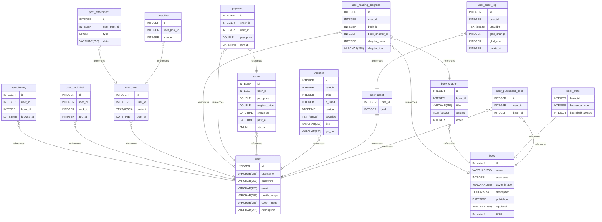

# nbread数据库设计 documentation
## Summary

- [Introduction](#introduction)
- [Database Type](#database-type)
- [Table Structure](#table-structure)
	- [user](#user)
	- [user_asset](#user_asset)
	- [user_history](#user_history)
	- [user_bookshelf](#user_bookshelf)
	- [user_reading_progress](#user_reading_progress)
	- [user_post](#user_post)
	- [post_attachment](#post_attachment)
	- [post_like](#post_like)
	- [book](#book)
	- [book_chapter](#book_chapter)
	- [book_stats](#book_stats)
	- [order](#order)
	- [payment](#payment)
	- [voucher](#voucher)
	- [user_asset_log](#user_asset_log)
	- [user_purchased_book](#user_purchased_book)
- [Relationships](#relationships)
- [Database Diagram](#database-diagram)

## Introduction

## Database type

- **Database system:** MySQL
## Table structure

### user

| Name        | Type          | Settings                      | References                    | Note                           |
|-------------|---------------|-------------------------------|-------------------------------|--------------------------------|
| **id** | INTEGER | 🔑 PK, not null, unique, autoincrement |  | |
| **username** | VARCHAR(255) | null |  | |
| **password** | VARCHAR(255) | null |  | |
| **email** | VARCHAR(255) | null |  | |
| **profile_image** | VARCHAR(255) | null |  | |
| **cover_image** | VARCHAR(255) | null |  | |
| **description** | VARCHAR(255) | null |  | | 

### user_asset

| Name        | Type          | Settings                      | References                    | Note                           |
|-------------|---------------|-------------------------------|-------------------------------|--------------------------------|
| **user_id** | INTEGER | 🔑 PK, not null | fk_user_asset_user_id_user | |
| **gold** | INTEGER | null |  | | 

### user_history

| Name        | Type          | Settings                      | References                    | Note                           |
|-------------|---------------|-------------------------------|-------------------------------|--------------------------------|
| **id** | INTEGER | 🔑 PK, not null, unique, autoincrement |  | |
| **user_id** | INTEGER | null | fk_user_history_user_id_user | |
| **book_id** | INTEGER | null |  | |
| **browse_at** | DATETIME | null |  | | 

### user_bookshelf

| Name        | Type          | Settings                      | References                    | Note                           |
|-------------|---------------|-------------------------------|-------------------------------|--------------------------------|
| **id** | INTEGER | 🔑 PK, not null, unique, autoincrement |  | |
| **user_id** | INTEGER | null | fk_user_bookshelf_user_id_user | |
| **book_id** | INTEGER | null |  | |
| **add_at** | INTEGER | null |  | | 

### user_reading_progress

| Name        | Type          | Settings                      | References                    | Note                           |
|-------------|---------------|-------------------------------|-------------------------------|--------------------------------|
| **id** | INTEGER | 🔑 PK, not null, unique, autoincrement |  | |
| **user_id** | INTEGER | null | fk_user_reading_progress_user_id_user | |
| **book_id** | INTEGER | null | fk_user_reading_progress_book_id_book | |
| **book_chapter_id** | INTEGER | null | fk_user_reading_progress_chapter_id_book_chapter | |
| **chapter_order** | INTEGER | null |  | |
| **chapter_title** | VARCHAR(255) | null |  | | 

### user_post

| Name        | Type          | Settings                      | References                    | Note                           |
|-------------|---------------|-------------------------------|-------------------------------|--------------------------------|
| **id** | INTEGER | 🔑 PK, not null, unique, autoincrement |  | |
| **user_id** | INTEGER | null | fk_user_post_user_id_user | |
| **content** | TEXT(65535) | null |  | |
| **post_at** | DATETIME | null |  | | 

### post_attachment

| Name        | Type          | Settings                      | References                    | Note                           |
|-------------|---------------|-------------------------------|-------------------------------|--------------------------------|
| **id** | INTEGER | 🔑 PK, not null, unique, autoincrement |  | |
| **user_post_id** | INTEGER | null | fk_post_attachment_user_post_id_user_post | |
| **type** | ENUM | null |  | |
| **data** | VARCHAR(255) | null |  | | 

### post_like

| Name        | Type          | Settings                      | References                    | Note                           |
|-------------|---------------|-------------------------------|-------------------------------|--------------------------------|
| **id** | INTEGER | 🔑 PK, not null, unique, autoincrement |  | |
| **user_post_id** | INTEGER | null | fk_post_like_user_post_id_user_post | |
| **amount** | INTEGER | null |  | | 

### book

| Name        | Type          | Settings                      | References                    | Note                           |
|-------------|---------------|-------------------------------|-------------------------------|--------------------------------|
| **id** | INTEGER | 🔑 PK, not null, unique, autoincrement |  | |
| **name** | VARCHAR(255) | null |  | |
| **username** | INTEGER | null |  | |
| **cover_image** | VARCHAR(255) | null |  | |
| **description** | TEXT(65535) | null |  | |
| **publish_at** | DATETIME | null |  | |
| **vip_level** | VARCHAR(255) | null |  | |
| **price** | INTEGER | null |  | | 

### book_chapter

| Name        | Type          | Settings                      | References                    | Note                           |
|-------------|---------------|-------------------------------|-------------------------------|--------------------------------|
| **id** | INTEGER | 🔑 PK, not null, unique, autoincrement |  | |
| **book_id** | INTEGER | null | fk_book_chapter_book_id_book | |
| **title** | VARCHAR(255) | null |  | |
| **content** | TEXT(65535) | null |  | |
| **order** | INTEGER | null |  | | 

### book_stats

| Name        | Type          | Settings                      | References                    | Note                           |
|-------------|---------------|-------------------------------|-------------------------------|--------------------------------|
| **book_id** | INTEGER | 🔑 PK, not null | fk_book_stats_book_id_book | |
| **browse_amount** | INTEGER | null |  | |
| **bookshelf_amount** | INTEGER | null |  | | 

### order

| Name        | Type          | Settings                      | References                    | Note                           |
|-------------|---------------|-------------------------------|-------------------------------|--------------------------------|
| **id** | INTEGER | 🔑 PK, not null, unique, autoincrement |  | |
| **user_id** | INTEGER | null | fk_order_user_id_user | |
| **pay_price** | DOUBLE | null |  | |
| **original_price** | DOUBLE | null |  | |
| **create_at** | DATETIME | null |  | |
| **past_at** | DATETIME | null |  | |
| **status** | ENUM | null |  | | 

### payment

| Name        | Type          | Settings                      | References                    | Note                           |
|-------------|---------------|-------------------------------|-------------------------------|--------------------------------|
| **id** | INTEGER | 🔑 PK, not null, unique, autoincrement |  | |
| **order_id** | INTEGER | null | fk_payment_order_id_order | |
| **user_id** | INTEGER | null | fk_payment_user_id_user | |
| **pay_price** | DOUBLE | null |  | |
| **pay_at** | DATETIME | null |  | | 

### voucher

| Name        | Type          | Settings                      | References                    | Note                           |
|-------------|---------------|-------------------------------|-------------------------------|--------------------------------|
| **id** | INTEGER | 🔑 PK, not null, unique, autoincrement |  | |
| **user_id** | INTEGER | null | fk_voucher_user_id_user | |
| **price** | INTEGER | null |  | |
| **is_used** | INTEGER | null |  | |
| **past_at** | DATETIME | null |  | |
| **describe** | TEXT(65535) | null |  | |
| **title** | VARCHAR(255) | null |  | |
| **get_path** | VARCHAR(255) | null |  | | 

### user_asset_log

| Name        | Type          | Settings                      | References                    | Note                           |
|-------------|---------------|-------------------------------|-------------------------------|--------------------------------|
| **id** | INTEGER | 🔑 PK, not null, unique, autoincrement |  | |
| **user_id** | INTEGER | null | fk_user_asset_log_user_id_user_asset | |
| **describe** | TEXT(65535) | null |  | |
| **glad_change** | INTEGER | null |  | |
| **glod_now** | INTEGER | null |  | |
| **create_at** | INTEGER | null |  | | 

### user_purchased_book

| Name        | Type          | Settings                      | References                    | Note                           |
|-------------|---------------|-------------------------------|-------------------------------|--------------------------------|
| **id** | INTEGER | 🔑 PK, not null, unique, autoincrement |  | |
| **user_id** | INTEGER | null | fk_user_purchased_book_user_id_user | |
| **book_id** | INTEGER | null | fk_user_purchased_book_book_id_book | | 

## Relationships

- **user_history to user**: many_to_one
- **user_bookshelf to user**: many_to_one
- **user_post to user**: many_to_one
- **post_attachment to user_post**: many_to_one
- **post_like to user_post**: many_to_one
- **user_reading_progress to user**: many_to_one
- **user_reading_progress to book**: many_to_one
- **user_reading_progress to book_chapter**: many_to_one
- **book_chapter to book**: many_to_one
- **book_stats to book**: one_to_one
- **payment to order**: many_to_one
- **payment to user**: many_to_one
- **order to user**: many_to_one
- **voucher to user**: many_to_one
- **user_asset to user**: one_to_one
- **user_asset_log to user_asset**: many_to_one
- **user_purchased_book to user**: many_to_one
- **user_purchased_book to book**: many_to_one

## Database Diagram

